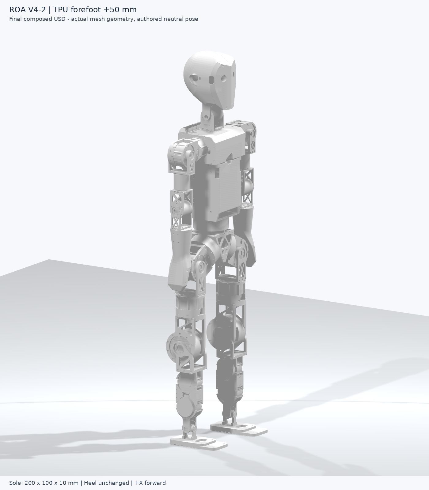

# roa_v4-2

A 12-DOF Roa robot USD model for Isaac Lab.

- `roa_v4-2.usd`: Main robot USD asset.
- `configuration/`: Base, robot, physics, and sensor USD layers.

Use `roa_v4-2.usd` as the robot asset in your Isaac Lab project. Keep the `configuration/` folder alongside it so the USD layers resolve correctly.

Licensed under [Apache 2.0](LICENSE).
